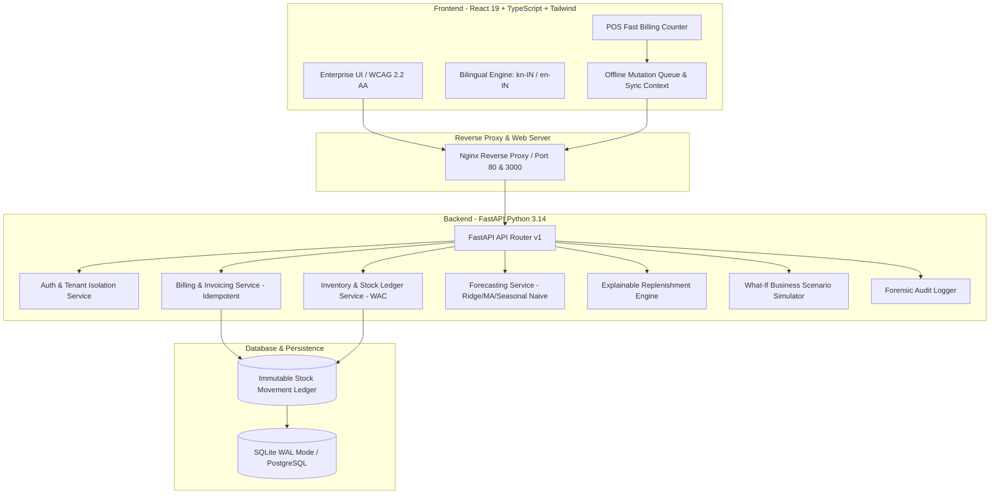

# SmartStock — Intelligent Inventory, Billing, Sales Analytics & Business Decision Platform

> **Engineered for independent retail shopkeepers in Karnataka (commencing in Haveri district)**  
> Built with **FastAPI (Python 3.14)**, **SQLAlchemy**, **SQLite WAL / PostgreSQL**, **scikit-learn**, **React 19**, **TypeScript**, and **Tailwind CSS**.

---

## 1. Executive Summary & Product Vision

SmartStock is a centralized, multi-tenant SaaS platform built to replace unorganized paper khata books, ad-hoc notebook billing, and blind restocking for independent shopkeepers in Karnataka. 

### Non-Negotiable Engineering Principles
1. **Real Business Data Only:** Strictly zero synthetic dummy records or fabricated KPI values. An empty shop displays an honest, helpful onboarding experience, never fake charts.
2. **Strict Multi-Tenant Isolation:** Derived from authenticated JWT session identity and verified at the database query layer. Every business operates in an impenetrable private silo.
3. **Concurrency-Safe Financials:** Concurrency-safe sequential invoice numbering (`INV-{YYYY}-{00001}`), idempotent billing retries, immutable stock movement ledger (`StockMovement`), and Weighted Average Cost (WAC) tracking.
4. **Evidence-Based ML Demand Forecasting:** Governed by a **14-Day Data Sufficiency Gate**. If a product has less than 14 days of genuine store sales history, statistical models refuse to guess and safely fall back to deterministic safety-stock rules.
5. **Full Kannada & English Localization:** Complete bilingual user interface tailored for Karnataka retail terminology (ಬಿಲ್ಲು, ದಾಸ್ತಾನು, ಖರೀದಿ, ಲಾಭ, ಖಾತೆ).
6. **Offline-First Synchronization:** Resilient local storage mutation queue for spotty rural connectivity with server-authoritative resolution and UUID idempotency tokens.

---

## 2. System Architecture



---

## 3. Core Modules & Production Capabilities

SmartStock includes 22 integrated operational modules:

| Module | Route / Key | Primary Functionality |
| :--- | :--- | :--- |
| **Landing & Onboarding** | `/` | Public landing page, shop registration, owner account creation, and login. |
| **Overview Dashboard** | `overview` | Real KPI metrics (net sales, gross profit, inventory valuation, active stock units). |
| **Point of Sale (POS)** | `pos` | Barcode scanning, instant search, CGST/SGST calculation, receipt printing, keyboard shortcut `F2`. |
| **Catalogue & Products** | `products` | Product management, SKU, barcode, unit, cost price, selling price, CSV bulk import with dry-run preview. |
| **Categories & Sections** | `categories` | Custom shop sections (e.g. Grocery, Spices, Dairy, Personal Care) with item counts. |
| **Stock Ledger & Batches** | `inventory` | Immutable ledger of movements, batch/lot tracking, expiry dates, manual audited adjustments. |
| **Purchase Orders** | `purchases` | Complete PO lifecycle (Draft, Ordered, Partial Delivery, Completed), lot creation, WAC recalculation. |
| **Suppliers & Vendors** | `suppliers` | Distributor directory, lead times (days), credit terms, fulfillment rate tracking. |
| **Sales & Invoices** | `sales` | Chronological invoice ledger, payment splits, receipt reprint, audited cancellations & restock. |
| **Customers & Khata** | `customers` | Digital Khata credit book, outstanding receivables, customer contact directory. |
| **Operating Expenses** | `expenses` | Shop rent, electricity, labor wages, freight, packaging, deducts directly from gross margin. |
| **Financial Analytics** | `analytics` | Net sales, COGS, gross margin %, operating profit, daily trend graph, top products, category mix. |
| **Demand Forecasting** | `forecasting` | 14-day data sufficiency gate, Ridge regression, MA7, MA14, Seasonal Naive, out-of-sample MAE/WAPE. |
| **Replenishment Engine** | `reorder` | Explainable Reorder Point ($ROP = \text{Lead Time Demand} + \text{Safety Stock}$), one-click Draft PO creation. |
| **Stock Ageing Intelligence** | `stock-ageing` | 0-30d, 31-60d, 61-90d, 90d+ cohorts, total dead stock capital locked in INR. |
| **Stock Reconciliation** | `reconciliation` | Physical stocktaking sessions, count entry, variance reporting (shrinkage/damage), atomic ledger adjust. |
| **What-If Simulator** | `simulator` | Interactive scenario stress-testing: supplier delivery delay (+3 to +14 days) and seasonal demand shocks. |
| **Ask Your Business** | `assistant` | Authorized natural language queries ("What was my profit this week?", "Which items need reordering?"). |
| **Unusual Activity Alerts** | `anomalies` | Automated detection of rapid stock depletion, large negative variance, abnormal discounts. |
| **Offline Sync Status** | `sync` | Local storage queue inspector, network heartbeat, manual sync trigger, idempotency token validation. |
| **Staff & Permissions** | `staff` | Staff invitations and role-based permissions (Owner, Manager, Cashier with hidden cost prices). |
| **Audit Logs** | `audit` | Immutable forensic audit trail capturing timestamp, user ID, entity type, and JSON snapshots. |
| **Shop Settings** | `settings` | Shop profile, legal entity name, GSTIN (15-digit), physical address, phone, and receipt preferences. |

---

## 4. Multi-Tenant Security & Tenant Isolation

1. **Authentication Token & Scope:**  
   JWT tokens contain `sub` (User ID) and default `business_id`. All requests pass through FastAPI dependencies (`get_current_business_id`) which validates that the user is an active member of that business.
2. **Database Query Isolation:**  
   Every query filter explicitly binds `business_id = current_business_id`. Insecure direct object reference (IDOR) attempts return HTTP 404 or 403.
3. **Automated Verification:**  
   Automated pytest suite (`test_tenant_cross_access_prevented`) confirms that Shop A cannot view, update, delete, or calculate analytics over Shop B's records.

---

## 5. Mathematical & Financial Exactness

### Concurrency-Safe Sequential Invoicing
Invoices use a transactional atomic sequence counter:
$$\text{INV}-\{YYYY\}-\{00001\}$$
Generated under row locks to guarantee zero gaps and zero duplicate invoice numbers under concurrent cashier operations.

### Weighted Average Cost (WAC) Basis
When purchase orders are received with new unit purchase costs:
$$\text{WAC}_{\text{new}} = \frac{(\text{Stock}_{\text{existing}} \times \text{WAC}_{\text{old}}) + (\text{Qty}_{\text{received}} \times \text{Cost}_{\text{unit}})}{\text{Stock}_{\text{existing}} + \text{Qty}_{\text{received}}}$$

### Explainable Reorder Point Formula
Replenishment orders explain their mathematical rationale:
$$\text{Reorder Point} = (\text{Avg Daily Demand} \times \text{Lead Time Days}) + \text{Safety Stock}$$
$$\text{Recommended Order Qty} = \max(\text{Min Order Qty}, \text{Reorder Point} - \text{Effective Stock})$$
where $\text{Effective Stock} = \text{Current Stock} + \text{Incoming PO Stock}$.

---

## 6. Local Development & Quickstart

### Prerequisites
- Python 3.11+ (Python 3.14 supported)
- Node.js 20+ and npm 10+
- Git

### 1. Clone & Set Up Backend
```powershell
cd backend
python -m venv venv
.\venv\Scripts\Activate.ps1
pip install -r requirements.txt
cp .env.example .env
```

Run tests to verify everything passes:
```powershell
python -m pytest tests/ -v
```

Start the FastAPI backend:
```powershell
uvicorn app.main:app --reload --port 8000
```
Backend API interactive docs: `http://localhost:8000/docs`

### 2. Set Up Frontend
```powershell
cd ..\frontend
npm install
npm run build
npm run dev
```
Frontend interface will be live at `http://localhost:5173`.

---

## 7. Containerized Docker Deployment

To spin up the complete production-grade application stack (FastAPI Backend + React Nginx Reverse Proxy):

```bash
docker compose up --build -d
```

- **Frontend Application:** `http://localhost:3000`
- **Backend API:** `http://localhost:8000/api/v1`
- **API Health Check:** `http://localhost:8000/api/v1/health`

---

## 8. Pilot Shop Onboarding Guide (Haveri District Retail Workflow)

For independent shopkeepers in Haveri, Byadgi, Ranebennur, or Shiggaon:

1. **Onboarding:** Register store name (e.g., *Haveri Agro & Provision Store*), enter GSTIN if registered, and select Kannada or English.
2. **Catalogue Setup:** Upload your existing product list using the CSV import tool (with column preview) or enter items using barcode scanner.
3. **Record Opening Stock:** Set opening inventory balances and purchase costs to establish initial WAC valuation.
4. **Distributor Integration:** Register local wholesale suppliers with their typical delivery lead times (e.g. 2 days from Hubballi, 4 days from Bangalore).
5. **Start Billing:** Use the POS counter (`F2`) for rapid cash, UPI QR, and Khata credit sales. Thermal receipts print with bilingual Kannada/English greeting.
6. **Reap Intelligence:** As 14 days of genuine sales accumulate, the demand forecasting engine automatically unlocks optimal restocking recommendations to eliminate stockouts and minimize dead stock capital lockup.

---

## 9. Verification & Automated Test Results

The backend contains a complete end-to-end test suite (`tests/test_smartstock_all.py`):
```
tests/test_smartstock_all.py::test_registration_login_and_tenant_isolation PASSED
tests/test_smartstock_all.py::test_tenant_cross_access_prevented PASSED
tests/test_smartstock_all.py::test_billing_pos_and_inventory_deduction PASSED
tests/test_smartstock_all.py::test_billing_idempotency_protection PASSED
tests/test_smartstock_all.py::test_purchases_and_partial_receiving PASSED
tests/test_smartstock_all.py::test_forecasting_data_sufficiency PASSED
tests/test_smartstock_all.py::test_reorder_recommendations PASSED
tests/test_smartstock_all.py::test_business_assistant_and_simulator PASSED
tests/test_smartstock_all.py::test_reconciliation_workflow PASSED
tests/test_smartstock_all.py::test_offline_sync_and_anomalies PASSED
====================== 10 passed in 4.78s =======================
```

Frontend production bundle verification:
```
dist/index.html                   0.45 kB │ gzip:   0.29 kB
dist/assets/index-CBGgtwEN.css   39.74 kB │ gzip:   7.34 kB
dist/assets/index-C0W3RYOG.js   514.76 kB │ gzip: 120.88 kB
✓ built in 1.31s (Zero TypeScript errors)
```
